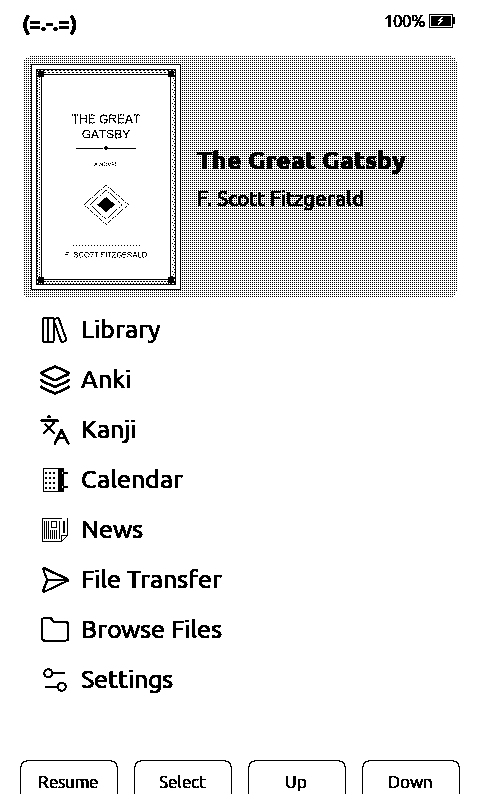
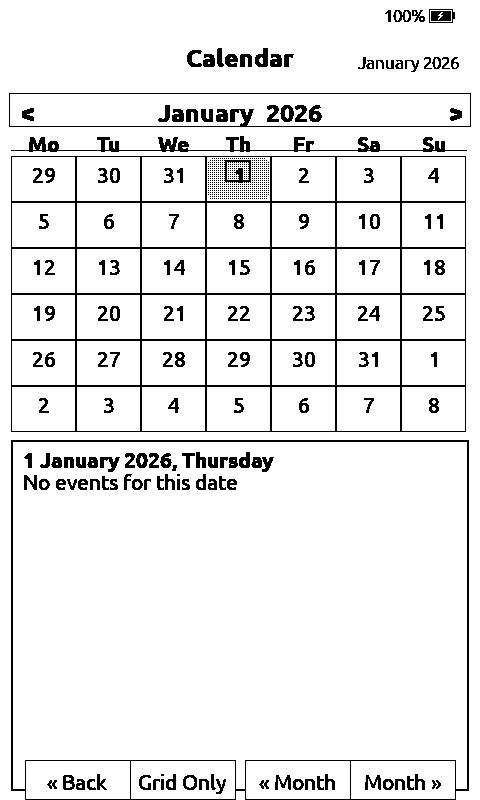
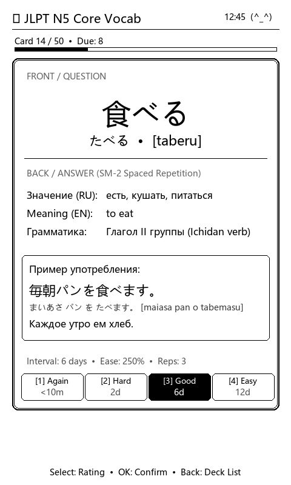
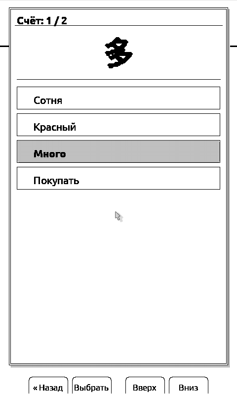

# JPink Reader 🌸

<div align="center">

[](https://github.com/MrProLopstar/JPink/releases)
[](LICENSE)
[](https://github.com/crosspoint-reader/crosspoint-reader)
[](https://www.espressif.com/)

**The ultimate open-source, Japanese-learning & productivity firmware for E-Ink readers.**  
*Forked from [CrossPoint Reader](https://github.com/crosspoint-reader/crosspoint-reader).*

[English](#-english) • [Русский](#-русский)

</div>

---

## 🌐 English

### About JPink
**JPink** is an enhanced, feature-packed fork of the open-source **[CrossPoint Reader](https://github.com/crosspoint-reader/crosspoint-reader)** firmware created by the CrossPoint Reader organization.

While preserving the core EPUB reading engine, typography, and battery efficiency of CrossPoint, **JPink** adds an integrated Japanese learning suite, interactive calendar, RSS news reader, custom themes, and system stability improvements.

---

### 🌟 Key Features

#### 🎌 Japanese Language Suite
* **Interactive Kana Matrix (5×10 Gojūon)**: Instant 1-click toggle between Hiragana and Katakana, directional navigation, 36pt high-legibility glyphs, Hepburn & Polivanov transcriptions, and historical Man'yōgana origins (`安 → あ`, `以 → い`).
* **Kanji Cards (JLPT N5 – N1)**: Full-screen character cards with On'yomi, Kun'yomi, radicals, stroke count, frequency index, English & Russian meanings, and compound word examples with zero dithering noise.
* **Interactive Quizzes & Drills**: Kana Quiz and JLPT N5 Kanji Quiz with smart distractor generation, instant checkmark/cross feedback, and streak score tracking.
* **Flashcards with Shuffle Mode**: Randomize flashcard order to reinforce visual recognition independently of alphabet sequence.

#### 📅 Interactive E-Ink Calendar
* High-contrast monthly calendar view with clear current-day highlighting.
* Intuitive controls: step through days, hold Left/Right to flip months, hold Up/Down to flip years.

#### 📰 RSS News Reader
* Download RSS/Atom feeds via Wi-Fi for distraction-free offline reading.

#### 🧠 Anki Spaced Repetition (SM-2)
* **True SM-2 Algorithm**: Ease Factor (130%–250%), calculated day intervals, lapse tracking, and 4 rating grades (Again, Hard, Good, Easy).
* **Smart Re-queueing**: Pressing "Again" immediately re-queues the card to the end of the current session so you master it before finishing.
* **Custom Decks via SD Card**: Drop any exported `.tsv` or `.txt` Anki deck into `/sdcard/anki/` (`Word [Tab] Meaning [Tab] Reading [Tab] Example`).
* **Session Summary**: End-of-deck statistics with review count, accuracy percentage, and completion badge.

#### 🎨 Modern UI & New Themes
* **Themes**: Classic, Lyra, Rounded Raff, Minimalist, and Brutalist.
* **Scroll Indicator (Slider)**: Dynamic slider bar on the Home screen for smooth navigation.
* **Kaomoji Status**: Real-time battery and network status shown via cute kaomoji (`(^_^)`, `(o_o)`).
* **Custom Sleep Screens**: Multiple artistic sleep screen options.

#### ⏱️ Manual Clock & NTP Sync
* Set time and date manually in `Settings → System → Clock → Set clock manually`.
* Automatic background SNTP synchronization over Wi-Fi.

#### 🛡️ Stability & Network Fixes
* **POSIX DNS**: Safe `getaddrinfo` resolution preventing lwIP lock panics during downloads.
* **Stable Wi-Fi**: Disabled aggressive modem sleep (`WiFi.setSleep(false)`) and enabled auto-reconnect.

---

### 📸 Screenshots

| Home Menu (Lyra) | Interactive Calendar | Kanji Study Card |
|:---:|:---:|:---:|
|  |  |  |

| Anki Spaced Repetition | Kanji Interactive Quiz | Hiragana / Katakana Table |
|:---:|:---:|:---:|
|  |  |  |

| Night Sleep Screen | Bookshelf Sleep Screen | Reading View |
|:---:|:---:|:---:|
|  |  |  |

---

### 📱 Supported Devices

| Device | MCU | Display Controller | Touch | Frontlight |
|:---|:---|:---|:---:|:---:|
| **Xteink X4** | ESP32-C3 | SSD1677 | No | Yes |
| **Xteink X3** | ESP32-C3 | SSD1677 | No | No |
| **Xteink X4Pro** | ESP32-S3 | UC8253 | Yes | Yes |
| **Xteink X4Classic** | ESP32-S3 | SSD1677 | No | Yes |
| **reTerminal Sticky** | ESP32-S3 | ED2208 | Yes | No |

---

### 🚀 Flashing & Quick Start

#### Method 1: 1-Click Flash Script (Recommended)
Ready-to-flash binaries are located in [`dist/`](dist/).
1. Connect your e-reader to your computer via USB-C.
2. Run the flashing script:
   * **Windows**: Double-click `flash.bat`
   * **Linux / macOS**: Run `./flash.sh`

#### Method 2: Web Installer
1. Open https://crosspointreader.com/#flash-tools in Chrome or Edge.
2. Select **Custom .bin** and upload [`dist/firmware.factory.bin`](dist/firmware.factory.bin).
3. Click **Flash**.

---

### 🛠️ Building from Source

```bash
git clone --recursive https://github.com/MrProLopstar/JPink.git
cd JPink

# Build for Xteink X4 (default)
pio run -e default
```

### 🖥️ Desktop Emulator & Testbench
Test UI layouts, fonts, and features directly on your PC without flashing physical hardware using the companion emulator:  
👉 **[xteink-emulator](https://github.com/MrProLopstar/xteink-emulator)**

---

### 💬 Feedback & Bug Reports

I am actively improving JPink! If you encounter any bugs, rendering issues, or have ideas:
* ⭐ **Star the Project**: If you like JPink, please consider giving it a star on GitHub! It helps more e-reader enthusiasts discover the project.
* 👉 **[Open an Issue / Submit Bug Report](https://github.com/MrProLopstar/JPink/issues)**
* Any feedback, reviews, ideas, and bug reports are warmly welcomed to help polish and bring this project to perfection!

---

<br/>

---

## 🇷🇺 Русский

### О проекте JPink
**JPink** — это расширенный форк открытой прошивки **[CrossPoint Reader](https://github.com/crosspoint-reader/crosspoint-reader)** (Copyright (c) 2025 CrossPoint Reader organization).

Сохраняя надежный движок для чтения книг и энергоэффективность оригинального CrossPoint, **JPink** превращает устройство в карманный помощник для изучения японского языка, интерактивный календарь и читалку новостей.

---

### 🌟 Основные возможности

* **Изучение японского языка**:
  * Интерактивная таблица каны (Gojūon 5×10) с мгновенным переключением Хирагана ⇄ Катакана, транскрипцией по Поливанову и Хэпбёрну, и кандзи-предками (манъёгана `安 → あ`);
  * Полноэкранные карточки Кандзи уровней JLPT N5–N1 с онъёми, кунъёми, ключами, чертами, переводами и примерами без серого дизеринга;
  * Интерактивные викторины (Kana Quiz & Kanji Quiz) с мгновенной проверкой ответов (`✔` / `✖`) и подсчетом очков;
  * Режим карточек со случайным перемешиванием (Shuffle).
* **Интервальные повторения Anki (SM-2)**:
  * Полноценный математический алгоритм SuperMemo-2 (Ease Factor, интервалы, забывания);
  * 4 градации оценок (Again / Hard / Good / Easy) с мгновенным возвратом карточки в хвост очереди при ошибке;
  * Загрузка любых пользовательских колод с microSD из файлов `.tsv` / `.txt`.
* **E-Ink Календарь**: четкая сетка месяца, удобное переключение дней, месяцев и лет, выделение сегодняшнего числа.
* **Интерфейс и темы**: темы Classic, Lyra, Rounded Raff, Minimalist и Brutalist, индикатор прокрутки (слайдер) в главном меню, каомодзи статуса батареи `(^_^)`, новые экраны сна.
* **Часы и дата**: ручная установка даты и времени в настройках системы + автосинхронизация по NTP через интернет.
* **Стабильность сети**: устранение падений lwIP при скачивании по HTTPS, стабильный Wi-Fi без засыпания радиомодуля.

---

### 🚀 Быстрая прошивка

Готовые бинарные файлы находятся в каталоге [`dist/`](dist/).
1. Подключите читалку к компьютеру кабелем USB-C.
2. Запустите скрипт:
   * **Windows**: запустите `flash.bat`
   * **Linux / macOS**: запустите `./flash.sh`

---

### 🖥️ Десктопный эмулятор и тестовый стенд
Для тестирования экранов, шрифтов и локализации на компьютере без прошивки ридера доступен отдельный эмулятор:  
👉 **[xteink-emulator](https://github.com/MrProLopstar/xteink-emulator)**

---

### 💬 Звёзды, отзывы и отчеты об ошибках

Проект активно развивается и дорабатывается!
* ⭐ **Поддержите проект звёздочкой**: Если JPink вам понравился, поставьте звезду репозиторию на GitHub — это здорово помогает проекту и мотивирует развивать его дальше!
* 👉 **[Создать Issue / Сообщить об ошибке](https://github.com/MrProLopstar/JPink/issues)**
* Очень жду ваши отзывы, предложения и отчеты об ошибках, чтобы довести проект до идеала!

---

### 📜 Лицензия

* Оригинальный исходный код: **MIT License** (CrossPoint Reader organization).
* Скомпилированная прошивка: **GNU General Public License v3 (GPLv3)** из-за использования криптографического стека wolfSSL.
* Подробности: [LICENSE](LICENSE) и [licenses/README.md](licenses/README.md).
